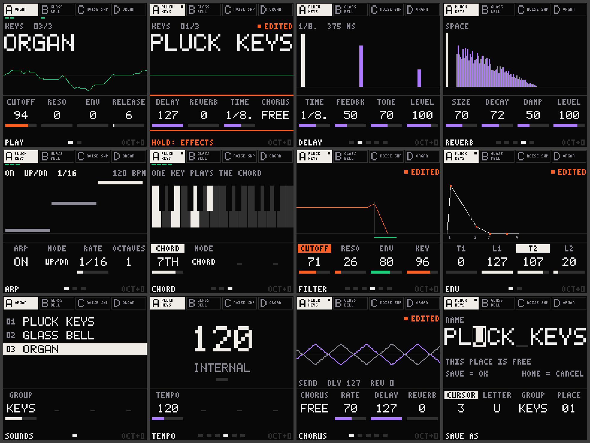

# 0008: Neue Oberfläche: ein Raster, eine Seitenreihe, Pixelschrift

- **Status:** vorgeschlagen
- **Stand:** 2026-11-12 (erste Stufe gebaut und im Emulator geprüft; am Gerät noch nicht)

## Kontext

Der Nutzer fand die Bedienung aus ADR 0007 „viel zu unübersichtlich“ und wünscht: intuitiv und einfach, aber mit der Tiefe, alles schnell zu bearbeiten; Pixelschrift, flüssige Animationen, Regler, die bei schnellem Drehen weiter springen; alle Tasten halb beleuchtet, aktive voll; freie Farbwahl. Vorbild sollen gut bewertete FM-1-Firmwares sein.

Angesehen wurden die meistinstallierten Firmwares des Firmware Hub (thefirmwarehub.com): SLOOP, OberVave und FM-106. Gemeinsam haben sie:

- KNOB 1–4 sind immer die vier Felder unten im Bild.
- Eine Funktionstaste öffnet ihre Seiten; SELECT blättert.
- ALGORITHM oder PRESETS wählen Spur und Sound.
- Eine Spielseite mit den wichtigsten vier Werten (OberVave: CUTOFF, RESO, ENV, RELEASE).
- Tastenlicht gedimmt, das Aktive voll (SLOOP); progressive Reglerbeschleunigung (SLOOP).

Pinterest ließ sich ohne Anmeldung nicht durchsuchen; die Gestaltung folgt deshalb diesen Firmwares und alten Hi-Fi- und Synth-Anzeigen.

## Entscheidung

### Eine Regel für das ganze Gerät

| Bedienelement | Bedeutung, überall |
|---|---|
| **KNOB 1–4** | die vier Felder unten im Bild |
| **SELECT** | Seite zurück / weiter (alle Seiten liegen in einer Reihe) |
| **PRESETS** | Sound zurück / weiter |
| **ALGORITHM** | Part A–D |
| **eine Taste** | springt auf ihre erste Seite; noch einmal: ihre nächste Seite |

Tasten: HOME (PLAY, MIX), EDIT (OSC 1–3, FILTER 1–2, AMP), ENV (1–2), LFO, FX (CHORUS mit Sends, DELAY 1–2, REVERB 1–2), ARP (ARP 1–2, CHORD), GLO (TEMPO, MIDI, VOICE 1–2, SYNC, SYSTEM), SEL (Soundliste nach Gruppen), PLAY (tippen: Arp-HOLD des Parts; halten: Start/Stop, ADR 0012), SAVE (kurz: speichern; lang: speichern unter), HOME lang: ungespeicherten Stand zurückholen, OCT− + OCT+: alle Töne aus.

### Live zuerst: halten statt blättern

Der Nutzer will das Gerät auf der Bühne spielen: die wichtigsten Werte sofort unter den Fingern, die Tiefe dahinter (12.11.2026).

- **Eine Seitentaste HALTEN** legt ihre vier wichtigsten Werte sofort auf KNOB 1–4, egal welche Seite gerade zu sehen ist; die Reglerfelder bekommen einen orangen Rahmen, die Fußzeile zeigt „HOLD: …“. **Loslassen:** Die Regler gehören wieder der Seite. So bleibt man auf PLAY und greift trotzdem alles.
- **Dieselbe Taste TIPPEN** (kürzer als 0,4 s, ohne zu drehen) öffnet ihre Seiten zum tiefen Bearbeiten.

| Taste halten | KNOB 1 | KNOB 2 | KNOB 3 | KNOB 4 |
|---|---|---|---|---|
| (keine, Seite PLAY) | CUTOFF | RESO | ENV | RELEASE |
| ENV | ATTACK | DECAY | SUSTAIN | RELEASE |
| LFO | RATE | DELAY | PITCH | FILTER |
| EDIT | PULSE | SAW | SUB | PW |
| FX | Delay-Send | Hall-Send | Delay-Zeit | Chorus |
| ARP | Arp an/aus | Modus | Rate | Akkord |
| GLO | Pegel A | Pegel B | Pegel C | Pegel D |

- **Die Kopfzeile zeigt immer alle vier Parts** mit Buchstabe, Soundname, klingenden Stimmen und einem roten Punkt bei ungespeicherten Änderungen. Der Name der Seite steht unten links.

### Ein Bildaufbau für alle Seiten

1. **Oben:** die Parts A–D mit ihren Sounds (der gewählte weiß, klingende Stimmen als grüne Striche darunter).
2. **Mitte:** das Bild der Seite: Soundname groß und Oszilloskop (PLAY), Wellenform (OSC), Filterkurve (FILTER), Hüllkurve (ENV), LFO-Welle mit laufendem Punkt (LFO), Liste (MIX, MIDI, SOUNDS).
3. **Unten:** vier Felder mit Name, Wert und Balken. Das zuletzt gedrehte ist in seiner Funktionsfarbe markiert.
4. **Fußzeile:** Name der Seite, ein Punkt je Seite der Gruppe, Oktave. Meldungen schieben sich von unten darüber.

Der Speichern-Dialog benutzt dasselbe Raster: KNOB 1 Cursor, KNOB 2 Buchstabe, KNOB 3 Gruppe, KNOB 4 Platz.

### Gestaltung

- **Pixelschrift:** 5×7 (die klassische Zeichen-LCD-Schrift) in zwei- und vierfacher Größe, 3×5 für Beschriftungen (`tools/make_font.py` → `app/mk_font.h`; seit 14.11.2026 `../shared/tools/make_font.py` → `../shared/ui/syn_font.h`).
- **Farben** (`app/mk_theme.h`): die der MKS-50-iOS-App des Nutzers (`Shared/UI/Controls.swift`, `Theme`), auf seinen Wunsch (12.11.2026). Fast schwarzer Grund, feine Trennlinien, **Weiß für das Gewählte** (Part, Listenzeile). Fünf Farben sagen auf jeder Seite, was ein Regler tut:
  - **Blau:** Klangquelle (Oszillator);
  - **Grün:** Modulation (LFO, Modulationstiefen) und das Oszilloskop;
  - **Orange:** Filter, außerdem Akzent für gehaltene Ebenen und „geändert“ (die App kennt kein Rot);
  - **Weiß:** Hüllkurve, Verstärker, Spielen;
  - **Violett:** Zeit und Effekte (Chorus, später Delay und Hall).
  Balken und Markierung eines Reglerfelds und die Kurve einer Seite tragen diese Farbe.
- **Animation:** 30 Bilder pro Sekunde; Seiten gleiten von der Seite herein (150 ms), Balken gleiten auf ihren Wert, das Scope steht durch Triggerung still, Meldungen fahren ein und aus.
- **Reglerbeschleunigung** (`enc_fast`): Der Schritt wächst mit den Rasten pro Sekunde (×1 bis ×12), nur bei Werten mit mehr als 16 Stufen. Im Emulator: 8 Rasten langsam = +8, schnell = +64.
- **Tastenlicht** (`lights_init`): alle Tasten und Knöpfe glimmen (Hintergrundschicht der Plattform, 8 µs je Abtastbild), die aktive Seite und gehaltene Tasten leuchten voll, SAVE blinkt bei ungespeicherten Änderungen.
- **Texte im Bild sind englisch** (wie die Beschriftung des Geräts und die Parameternamen).

### Latenz

Die Notentasten werden auch während des Zeichnens abgefragt (`keys_poll` zwischen den Bildstreifen und im Warten auf das Display), damit ein Bild von bis zu 30 ms keine Taste aufhält. MIDI läuft weiter im Audio-Interrupt (ADR 0004).

## Bilder der Seiten

AMP (Hüllkurve oder Gate), CHORUS (die zwei gegenläufigen Verzögerungen), DELAY (Echos nach Zeit und Feedback, Ping-Pong abwechselnd), REVERB (Vorverzögerung und Ausklang), ARP (die Töne des Musters, der laufende hell), CHORD (Akkord auf einer Tastatur), VOICE (sechs Stimmen nach Modus), TEMPO (BPM groß, Quelle, Taktlicht). Nur SYNC zeigt seinen Namen. Beschriftungen haben höchstens 7 Zeichen; längere werden kleiner gezeichnet.

## Alternativen

- **Abschnitt und Seite getrennt wählen** (ADR 0007: ALGORITHM Abschnitt, SEL Seite): zwei Ebenen, die man sich merken muss.
- **Vorhandene Schrift der Plattform (Terminus):** gut lesbar, aber keine Pixelschrift und nur zwei Größen.

## Folgen

- ADR 0007 ist in Bedienung und Farben abgelöst; Speichern und Kategorien (ADR 0006) bleiben.
- Jedes Bild wird neu gerechnet (8 Streifen), aber nur geänderte Streifen gehen ans Display.

## Verlauf

- 2026-11-12: angelegt; erste Stufe gebaut (Raster, Seitenreihe, Pixelschrift, Animation, Beschleunigung, Tastenlicht)
- 2026-11-12: auf Live ausgerichtet (Wunsch des Nutzers): Tasten halten = vier Werte sofort auf den Reglern, tippen = Seiten; Kopfzeile mit allen vier Parts
- 2026-11-12: Farben der iOS-App übernommen (Funktionsfarben je Regler), auf Wunsch des Nutzers
- 2026-11-12: Seiten für Delay, Hall, Arp, Akkord und Tempo (ADR 0009, 0010); PLAY schaltet Arp-HOLD; Bilder für alle Seiten außer SYNC
- 2026-11-14: GLO-Seiten beginnen mit TEMPO und MIDI; PLAY halten = Transport
- 2026-11-14: Dateien nach `../shared/` verschoben (Repo-ADR 0001), Entscheidung unverändert, Klang bitgleich
- 2026-11-14: Seite LFO: RATE, DELAY, WAVE, SYNC (RATE = Notenwert bei SYNC), zweite Seite KEYSYNC
- 2026-11-14: PW und PWM RT grau, solange weder PULSE noch SAW auf 3 steht (dort wirken sie nur, wie beim Alpha Juno); gedreht meldet das Display „PW WORKS ON PULSE 3 + SAW 3“. Wellenbild von PULSE 3 an die Engine angeglichen (TEST_10)
- 2026-11-14: Eine Taste bringt die Seite ihrer Gruppe zurück, die zuletzt offen war (erst danach die nächste). LFO RATE in Hz (die Kurve der Engine ist steil: 0–60 liegen unter 1 Hz); die Filter-LFO-Rate am Rechner und im Emulator nachgemessen (RATE 64 ≈ 1,2 Hz, 96 ≈ 10 Hz, 110 ≈ 24 Hz, wie die Kurve) (TEST_11)
- 2026-11-14: LFO-Bild nach den Formeln der Engine (echter Sinus, Dreieck mit richtiger Phase, S&H eine Stufe je Periode, Random weich); MIDI-Punkt im Part-Reiter blitzt, wenn auf dessen Kanal MIDI ankommt (TEST_12)
- 2026-11-14: Hintergrund reines Schwarz statt #0B0B0C (Wunsch des Nutzers: mehr Kontrast), MKS-50 0.1.2-alpha
- 2026-11-14: Oszilloskop auf HOME ruhig bei Stille (kein aufgeblasenes Rauschen); Sequencer auf SEQ und REC (ADR 0015), 0.2.0-alpha
- 2026-11-14: Hüllkurvenbild zeigt einen Punkt, der beim Spielen mit der jüngsten Stimme des Parts über die Kurve läuft; LFO-Punkt läuft auch ohne Note mit der eingestellten Rate (oder Clock und Notenwert); Filterbild zeigt bei Modulation eine grüne Linie am wirklichen Cutoff der jüngsten Stimme, 0.2.1-alpha
- 2026-11-14: Hüllkurvenpunkt sitzt auf der gezeichneten Linie (Anteil an der Zeit der Stufe statt des Pegels der Engine, der gekrümmt verläuft und das Release beim aktuellen Wert beginnt); auf der Doppelseite nur der Punkt der hellen Kurve; 0.2.2-alpha
- 2026-11-14: Cutoff-Anzeige: statt Strich und Punkt wandert die Tiefpasskurve selbst (Schulter, Spitze, Flanke) in der Akzentfarbe zum wirklichen Cutoff, die orange Kurve bleibt beim Regler (Wunsch des Nutzers: sah seltsam aus); 0.2.4-alpha
