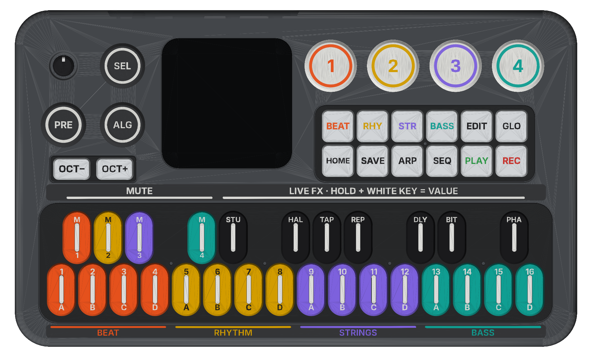
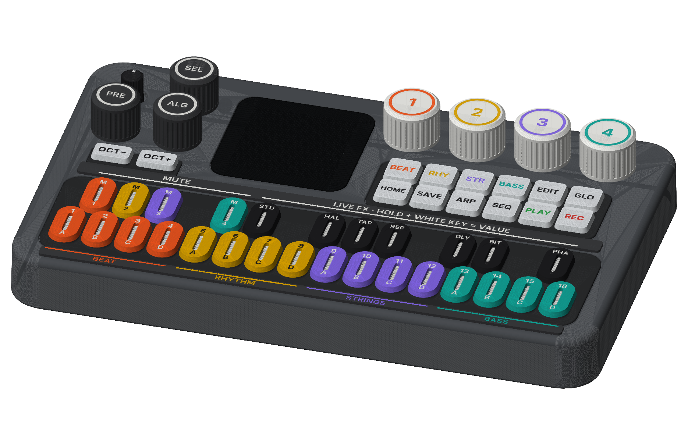

# Knöpfe, Kappen und Beschriftung zum Drucken

Druckteile für das M-VAVE FM-1, beschriftet und eingefärbt nach der FM1-Electro-Bedienung. Alle Maße stammen aus dem CAD-Modell des Geräts (siehe [`../fm1_model/MASSE.md`](../fm1_model/MASSE.md)). Das Gerät wird dafür **nicht geöffnet**.

## Teile

| Datei | Teile | Farbe Körper | Farbe Schrift |
|---|---|---|---|
| `stl/knobs.3mf` | 7 Drehknöpfe: SEL, PRE, ALG (Ø 13) und KNOB 1–4 (Ø 15) | SEL/PRE/ALG anthrazit, 1–4 weiß | weiß; 1–4 in den Bereichsfarben (in HOME sind KNOB 1–4 die Pegel von BEAT, RHYTHM, STRINGS, BASS) |
| `stl/buttons.3mf` | 12 Kappen für die Tasten rechts, 2 für OCT− / OCT+ | transluzent (natur) | Bereichstasten in ihrer Farbe, PLAY grün, REC rot, sonst schwarz |
| `stl/keys.3mf` | 27 Tastenkappen mit Fenster für den LED-Streifen | vordere Reihe: je 4 in BEAT-, RHYTHM-, STRINGS-, BASS-Farbe; hintere Reihe: 1–4 in den Bereichsfarben, 5–11 schwarz | weiß (auf Gelb schwarz) |
| `stl/strips.3mf` | 2 Beschriftungsleisten zum Aufkleben: vor den Tasten (Bereiche über ihren Plätzen A–D) und hinter den Tasten (MUTE, LIVE FX) | anthrazit | Bereichsfarben, weiß |
| `stl/fit_test.stl` | Passungstest für die Knöpfe | beliebig | |

Zu jeder 3MF-Datei gibt es `…_body.stl` (alle Körper) und `…_text.stl` (alle Einlagen), falls dein Slicer 3MF nicht mag.

**Beschriftung der Tasten**

- **Vordere Reihe:** oben die Nummer 1–16 (Schritte, Notenwerte, Repeat-Schritt), unten der Platz A–D. In HOME wählen die weißen Tasten 1–4 BEAT A–D, 5–8 RHYTHM, 9–12 STRINGS, 13–16 BASS.
- **Hintere Reihe:** 1–4 „M“ für Mute der vier Bereiche, 5–11 die Live-Effekte: STU(tter), HAL(l-Wurf), TAP(e-Stop), REP(eat), DLY (Delay), BIT(crusher), PHA(ser).
- **Tasten rechts:** BEAT, RHY, STR, BASS (die Bereichstasten FX, SEL, ENV, LFO des Geräts), EDIT, GLO, HOME, SAVE, ARP, SEQ, PLAY, REC.

MASTER behält seinen Knopf: Das ist der Lautstärkeregler, mit eigener Markierung.

## So sitzen die Teile

| Teil | Sitz |
|---|---|
| Drehknöpfe | Die Encoder haben gerändelte Achsen (Ø 6, 20 Zähne) ohne Knopf. Die Bohrung klemmt auf der Rändelung (Ø 5,85) und hat über dem glatten Bund Luft. Der Knopf sitzt auf dem Achsende und steht 0,7 mm über dem Gehäuse. |
| Kappen rechts und OCT | Sie stecken mit 0,1 mm Luft auf dem oberen halben Millimeter der Silikontaste. Darunter bleiben 0,8 mm (OCT 1,0 mm) frei zum Drücken. |
| Tastenkappen | genauso, 0,5 mm über die Flanke, 1,0 mm Weg bleibt frei. Das Fenster (1,4 × 8,4) lässt den LED-Streifen durch. |
| Leisten | Sie liegen auf dem flachen Gehäuse vor und hinter der Tastatur und bleiben 0,4 mm von den Taschen der Silikonmatten weg. Sie sind 0,8 mm dick. |

Die Silikontasten haben keinen Hinterschnitt, der eine Kappe hält. Klebe die Kappen deshalb mit einem Punkt Silikonkleber (z. B. Sil-Poxy) oder dünnem doppelseitigem Silikon-Klebeband auf. **Kein Sekundenkleber:** Er hält auf Silikon nicht und kann in die Matte laufen. Kappen aus transluzentem Material lassen die Tasten-LEDs durchscheinen. Druckst du sie deckend, siehst du nicht mehr, welche Taste leuchtet.

## Drucken

- **Mehrfarbig** (AMS, MMU, Werkzeugwechsler): 3MF öffnen, Körper und Schrift sind eigene Objekte, im Namen steht die vorgesehene Farbe, z. B. `W5 body [rhythm]`. Die Schrift ist 0,4 mm tief eingelegt und liegt auf dem Bett: Sie wird in den ersten zwei Schichten gedruckt.
- **Einfarbig:** nur `…_body.stl` drucken. Die Schrift ist dann 0,4 mm vertieft und lässt sich mit Acrylfarbe füllen (auftragen, abwischen).
- Alle Teile liegen schon richtig herum, **Oberseite auf dem Bett**, ohne Stützen.
- PLA oder PETG, Düse 0,4 (für die Schrift auf den Tasten besser 0,25–0,3), Schicht 0,2 für die ersten zwei Schichten, danach 0,1–0,15. Glattes oder texturiertes PEI, wie die Oberfläche aussehen soll.
- Knöpfe: 100 % Füllung, 3 Wände.

## Erst testen

1. `fit_test.stl` drucken und auf eine Encoder-Achse stecken (nicht MASTER). Die Bohrungen sind 5,6 bis 6,1 mm, die Punkte zählen von 1 (5,6) bis 7 (6,1). Die Bohrung, die stramm sitzt und sich ohne Kraft wieder abziehen lässt, kommt in `P['bore']` in `make_parts.py`.
2. Eine Tastenkappe und eine Kappe rechts einzeln drucken und probieren. Klemmen sie, `P['clr']` um 0,05 erhöhen. Wackeln sie zu sehr, um 0,05 senken.
3. Dann `python3 make_parts.py` ausführen. Das braucht `pip install manifold3d trimesh numpy matplotlib networkx lxml` und die Schrift Inter. Danach alles drucken.

## Anpassen

In `make_parts.py` stehen oben die gemessenen Maße, darunter die Passung `P` und die Farben `COL`. Die Beschriftungen stehen in `key_cap()` (Tasten), `BUTTONS` (Tasten rechts), `build()` (Knöpfe) und `strip_front()` / `strip_back()`. Die Teile werden am Gerät gebaut (dieselben Koordinaten wie in `MASSE.md`) und dann für den Druck umgedreht.

## Abnehmen

Kappen und Leisten lassen sich mit einem Fingernagel oder einer Plastikkarte abheben, Kleberreste gehen mit etwas Isopropanol ab. Die Knöpfe gerade nach oben abziehen, nicht hebeln.
