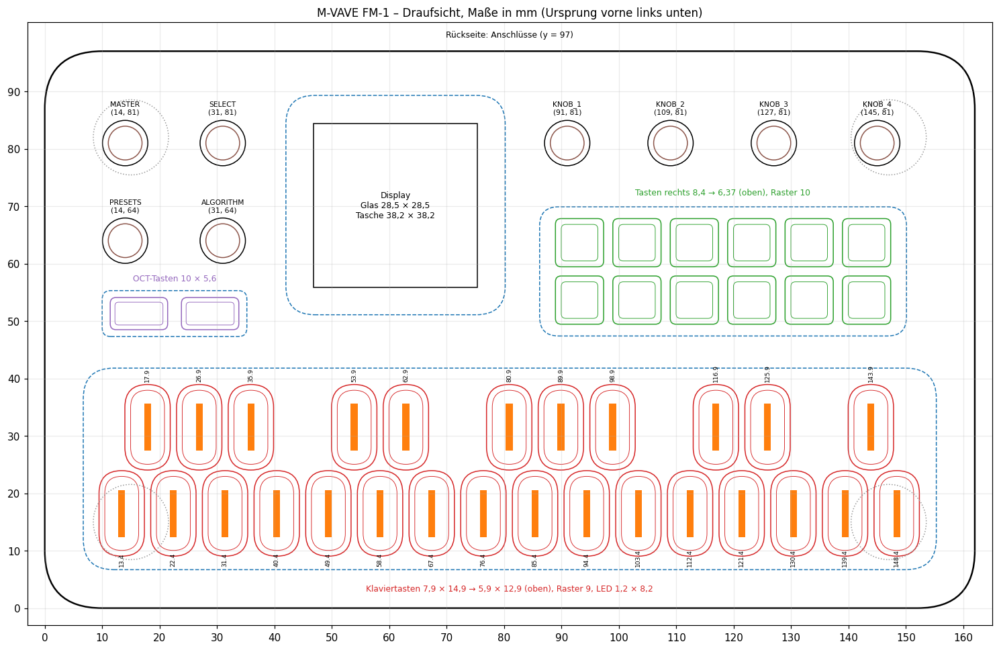
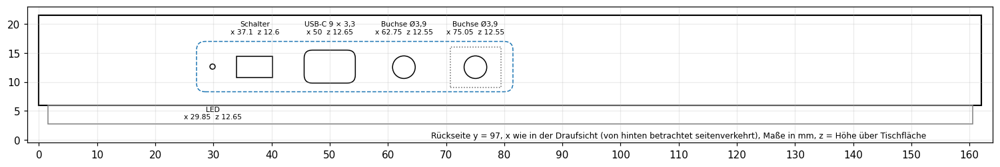

# Maße des FM-1 (aus dem CAD-Modell)

Abgenommen aus `FM1.stp` (Plasticity, Einheit mm) und der in Bauteile zerlegten OBJ-Fassung. Koordinaten: Ursprung links vorne unten, x nach rechts, y nach hinten (Anschlüsse bei y = 97), z nach oben (z = 0 = Tischfläche). Die Gehäuseoberseite liegt bei **z = 21,5**. Genauigkeit etwa 0,1 mm; für stramme Passungen trotzdem erst einen Test drucken.

| Datei | Inhalt |
|---|---|
| `MASSE.md` | diese Übersicht |
| `fm1_dimensions.json` | alle Werte maschinenlesbar |
| `fm1_panel.scad` | dieselben Werte als OpenSCAD-Bibliothek: Umriss, Bedienelemente, Referenzkörper, Beispiel-Frontplatte |
| `fm1_top.png`, `fm1_back.png` | bemaßte Draufsicht und Rückseite |

## Gehäuse

| Maß | Wert |
|---|---|
| Außenmaß | 162,0 × 97,0 mm |
| Eckradius (Draufsicht) | 10 mm |
| Flache Oberseite | ab ca. 2 mm vom Rand (Kantenradius 2) |
| Höhe ohne Knöpfe | 21,5 mm, mit Encoder-Achsen 28,2 mm |
| Panel | 2 mm stark (Unterseite z 19,5) |
| Gehäuseschale | Unterkante z 6,0; darunter die Bodenwanne x 1,5–160,5, y 1,5–95,5, z 2,7–9,0 |
| Füße (4) | Ø 13,1, 9,0 hoch (z 0–9), in Aufnahmen Ø 14,2; Mitten (15 / 15), (15 / 82), (147 / 82), (147 / 15) |
| Lautsprecher | Ø 26,5 bei (24,2 / 34,5), z 5–9 |

## Vertiefungen im Panel

Tastenmatten und Display liegen in Taschen, **0,5 mm tief** (Boden z 21,0). Die Silikonmatten sind 0,45 dick, ihre Oberfläche liegt bei z 21,45.

| Tasche | Mitte | Größe | Eckradius | Matte darin |
|---|---|---|---|---|
| Klaviertasten | (81 / 24,25) | 148,6 × 35,1 (x 6,7–155,3, y 6,7–41,8) | 5,3 | x 7,1–154,9, y 7,1–41,4 |
| Tasten rechts | (118,15 / 58,65) | 63,9 × 22,5 | 3,3 | x 86,5–149,8, y 47,7–69,6 |
| OCT-Tasten | (22,6 / 51,3) | 25,2 × 8,0 | 1,5 | x 10,3–34,9, y 47,6–55,0 |
| Display | (61,1 / 70,2) | 38,2 × 38,2 (x 42,0–80,2, y 51,1–89,3) | 5 | – |

Neben den Matten bleibt pro Seite nur etwa 0,4 mm Luft.

## Klaviertasten (27, Silikon)

Form: Stadion (Enden halbrund), Flanken 30° zur Senkrechten, oben 0,5-mm-Rundung.

| Maß | Wert |
|---|---|
| Fuß (z 21,5) | 7,9 × 14,9 mm (gerader Teil 7,0 mm) |
| Oberfläche (z 23,0) | 5,9 × 12,9 mm, davon plan 5,42 × 12,42 |
| Höhe über Gehäuse | 1,5 mm |
| Raster | 9,0 mm |
| LED-Streifen in der Mitte | Lichtleiter 1,2 × 8,2 mm (sichtbar plan 0,86 × 7,86), 0,1 mm vertieft |
| Vordere Reihe („weiß“, 16) | y = 16,5; x = 13,4 + 9 · n (n = 0 … 15) |
| Hintere Reihe („schwarz“, 11) | y = 31,5; x = 17,9 · 26,9 · 35,9 · 53,9 · 62,9 · 80,9 · 89,9 · 98,9 · 116,9 · 125,9 · 143,9 |
| Abstand am Fuß | seitlich 1,1 mm; zwischen den Reihen (Rund zu Rund) 1,3 mm |

## Tasten rechts (12, Raster 2 × 6)

Form: abgerundetes Quadrat, Flanken 25°.

| Maß | Wert |
|---|---|
| Fuß (z 21,5) | 8,4 × 8,4 mm |
| Oberfläche (z 22,76) | 6,37 × 6,37 mm plan |
| Höhe über Gehäuse | 1,26 mm |
| Raster | 10,0 mm in x und y |
| Mitten x | 93,15 · 103,15 · 113,15 · 123,15 · 133,15 · 143,15 |
| Hintere Reihe (y 63,65) | FX · SEL · ENV · LFO · EDIT · GLO (FM1-Electro: BEAT · RHYTHM · STRINGS · BASS · EDIT · GLO) |
| Vordere Reihe (y 53,65) | HOME · SAVE · ARP · SEQ · PLAY · REC |

## OCT-Tasten (2)

| Maß | Wert |
|---|---|
| Fuß | 10,0 × 5,6 mm |
| Oberfläche (z 23,0) | 8,36 × 3,96 mm plan |
| Höhe über Gehäuse | 1,5 mm |
| Mitten | OCT− (16,4 / 51,3), OCT+ (28,8 / 51,3) |

## Drehgeber und MASTER

Die sieben Encoder haben **gerändelte Achsen ohne Knopf**: Ø 6,0 mm, 20 Zähne (Typ EC11, „F-Achse“).

| Maß | Wert |
|---|---|
| Loch im Panel | Ø 7,9, oben auf Ø 8,5 angefast (um den Bund 0,95 mm Luft) |
| Achse | Ø 6,0, glatt bis z 23,0, darüber gerändelt (Kopf Ø 5,87, Grund Ø 5,08) bis z 28,2, oben auf Ø 5,1 angefast |
| Länge über Gehäuse | 6,7 mm, davon 5,2 mm gerändelt |
| SELECT | (31 / 81) |
| PRESETS | (14 / 64) |
| ALGORITHM | (31 / 64) |
| KNOB 1 – 4 | (91 / 81) · (109 / 81) · (127 / 81) · (145 / 81), Abstand 18 mm |
| MASTER (Poti) | (14 / 81), feiner gerändelt (Grund Ø 5,55, ab z 21,9), ab z 25 geschlitzt (innen Ø 2,4), weißer Zeiger 0,9 × 1,3 im Schlitz |
| Abstand links | 17 mm in x und y |

Platz für Knöpfe: links bis Ø 14 mm, rechts bis Ø 15 mm (3 mm Luft zum Nachbarn).

Die Knöpfe und Kappen in [`../caps`](../caps) sind auf diese Maße eingestellt: Rändelbohrung mit 20 Zähnen, Kappen für die Tasten rechts.

## Display

- Rahmen x 42,4–79,8, y 51,5–88,9 (37,4 × 37,4), z 21,0–21,5, in der Tasche x 42,0–80,2, y 51,1–89,3.
- Glas 28,5 × 28,5, x 46,825–75,325, y 55,9–84,4.

## Rückseite (y = 97)

Die Anschlüsse liegen in einer 1,5 mm tiefen Mulde, x 27,1–81,5, z 8,3–17,0. Positionen als (x / z):

| | Mitte | Größe |
|---|---|---|
| LED | (29,85 / 12,65) | Ø 0,9 |
| Ein/Aus-Schalter | Schlitz x 34,0–40,2, z 10,8–14,4 | Hebel 3,5 × 3,5 |
| USB-C | (50,0 / 12,65) | 9,0 × 3,3 |
| Buchse 1 | (62,75 / 12,55) | Ø 3,9 |
| Buchse 2 | (75,05 / 12,55) | Ø 3,9, mit Bund 8,7 × 7,0 |

## Hinweise für eigene Teile

- **Frontplatte auf dem Panel:** höchstens 1,2 mm dick, sonst lassen sich die Tasten rechts (1,26 über dem Panel) nicht mehr drücken. Um jedes Element 0,3–0,5 mm Luft lassen. `fm1_overlay()` in `fm1_panel.scad` ist ein Beispiel.
- **Rahmen oder Hülle:** `fm1_outline()` und `fm1_reference()` aus `fm1_panel.scad` als Körper zum Abziehen nutzen, die Rückseite nach der Tabelle oben aussparen.
